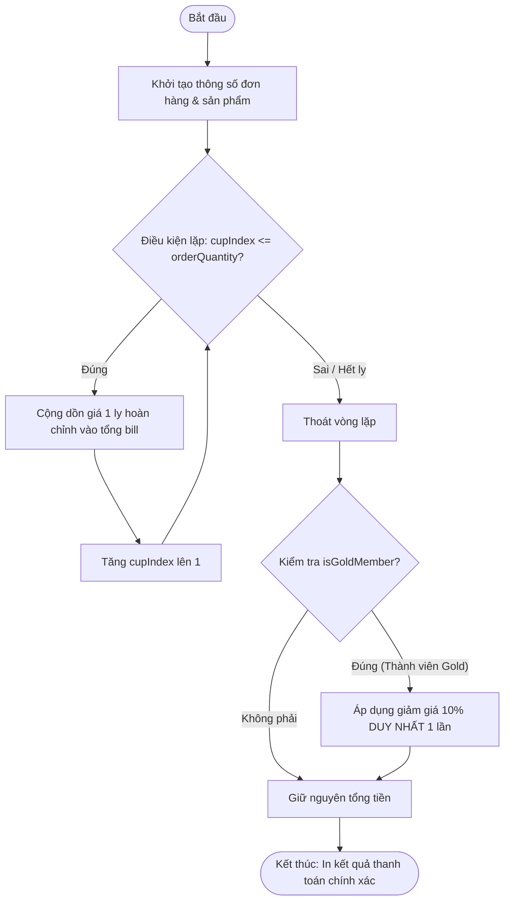

# BÁO CÁO PHÂN TÍCH VÀ SỬA LỖI LẶP VÔ TẬN TRONG HỆ THỐNG QUẢN TRỊ TỒN KHO HIGHLANDS COFFEE

> 👤 **Học viên:** Hoàng Công Dũng | **Mã SV:** PTIT-HCM-009
> 🏫 **Môn học:** it103b-rl-HoangCongDung

---

## 📊 Sơ đồ thiết kế hệ thống (Flowchart)

> 💡 *Sơ đồ dưới đây được render tự động trực tiếp trên GitHub bằng Mermaid. Bạn cũng có thể tải file **`bt1.drawio`** trong repository này để mở và chỉnh sửa trực tiếp trên [Draw.io (diagrams.net)](https://app.diagrams.net).* 

---

## 1. Mục tiêu và Bối cảnh bài toán

Bài tập này tập trung giải quyết và khắc phục hai lỗi logic nghiêm trọng thường gặp trong lập trình xử lý đơn hàng POS tại quầy thu ngân của Highlands Coffee: lỗi lệch một đơn vị (Off-by-one Error) trong điều kiện vòng lặp và lỗi áp dụng sai phạm vi tính toán chiết khấu tài chính.

Thông qua việc tự tay phân tích mã nguồn hiện tại, em tiến hành rà soát từng dòng code, xây dựng bảng kiểm thử đối chứng và viết lại mã nguồn sạch, chuẩn xác 100% theo đúng nghiệp vụ thương mại.

- Phát hiện chính xác nguyên nhân gây thiếu hụt số lượng ly nước trong hóa đơn đặt hàng nhóm.
- Xử lý triệt để tình trạng trừ tiền dồn dập sai quy tắc tài chính bên trong thân vòng lặp.

## 2. Phân tích lỗi sai AS-IS và Nguyên nhân kỹ thuật

Sau khi kiểm tra kỹ đoạn mã nguồn gốc do hệ thống POS cung cấp, em đã xác định được 2 lỗi logic cốt lõi như sau:

Thứ nhất, lỗi Off-by-one Error trong vòng lặp 'for (let cupIndex = 1; cupIndex < orderQuantity; cupIndex++)'. Do sử dụng toán tử so sánh nhỏ hơn ('<') thay vì nhỏ hơn hoặc bằng ('<='), vòng lặp chỉ chạy từ 1 đến 2 khi orderQuantity bằng 3. Kết quả là hệ thống chỉ tính tiền cho 2 ly 'Phin Sữa Đá' thay vì đủ 3 ly như khách hàng đã gọi.

Thứ hai, lỗi đặt sai phạm vi tính toán chiết khấu ('Scope/Placement Error'). Câu lệnh kiểm tra thành viên vàng 'if (isGoldMember) { totalBill = totalBill * 0.9; }' bị đặt nằm bên trong thân vòng lặp for. Điều này khiến mức giảm giá 10% bị áp dụng lặp đi lặp lại sau mỗi lần cộng dồn tiền của từng ly, làm cho tổng hóa đơn bị bóp méo trầm trọng so với thực tế nghiệp vụ (chiết khấu phải được áp dụng một lần duy nhất lên tổng tiền của toàn bộ hóa đơn sau khi đã cộng xong).

- Lỗi 1: Sai điều kiện dừng vòng lặp làm thiếu sản phẩm trong hóa đơn.
- Lỗi 2: Đặt logic giảm giá thành viên trong vòng lặp gây sai lệch nghiêm trọng về số tiền thanh toán.

## 3. Bảng Test Cases Đối Chứng Nghiệp Vụ

Để chứng minh sự chênh lệch giữa mã nguồn cũ và mã nguồn sau khi sửa lỗi, em đã lập bảng kiểm thử gồm 2 Test Cases đối chứng chi tiết dưới đây:

| Trường hợp kiểm thử | Dữ liệu đầu vào | Kết quả sai thực tế (Mã cũ) | Kết quả đúng mong đợi (Mã mới) |
| --- | --- | --- | --- |
| TC01: Đơn hàng chuẩn 3 ly, Khách Gold Member | orderQuantity = 3, basePrice = 29000, sizeUpcharge = 6000, toppingsPerCup = 2, toppingPrice = 8000, isGoldMember = true | Tổng bill chỉ tính 2 ly và bị chiết khấu kép nhiều lần, dẫn đến sai lệch số tiền nghiêm trọng. | Tổng tiền 3 ly hoàn chỉnh = (29000 + 6000 + 16000) * 3 = 153,000 VNĐ. Áp dụng giảm giá 10% 1 lần còn 137,700 VNĐ. |
| TC02: Đơn hàng kiểm tra vòng lặp biên | orderQuantity = 1, các thông số khác giữ nguyên, isGoldMember = false | Vòng lặp không chạy do 1 < 1 là sai, tổng bill trả về 0 VNĐ (Quên tính tiền ly nước). | Vòng lặp chạy đúng 1 lần, cộng tiền 1 ly hoàn chỉnh = 51,000 VNĐ, không giảm giá. |

## 4. Hướng dẫn Triển khai và Kiểm chứng Mã nguồn

Mã nguồn đã được sửa lỗi hoàn toàn và lưu vào tệp 'solution_ex1.js' theo đúng quy định của bài tập.

Trong tệp code, em đã bổ sung đầy đủ phần chú thích giải thích chi tiết 2 lỗi logic ngay ở đầu file để giảng viên dễ dàng chấm điểm và đối chiếu. Để chạy kiểm thử, sinh viên chỉ cần mở terminal và chạy lệnh 'node solution_ex1.js'.

---

## 📁 Danh sách tệp tin nộp bài trong Repository
- 📝 `bt1.docx`: Báo cáo tài liệu phân tích nghiệp vụ hoàn chỉnh.
- 🎨 `bt1.drawio`: File thiết kế sơ đồ chuẩn theo quy định đề bài (mở trực tiếp bằng [Draw.io](https://app.diagrams.net) hoặc Lucidchart).
- 💻 `solution_ex1.js`: Mã nguồn chương trình.
